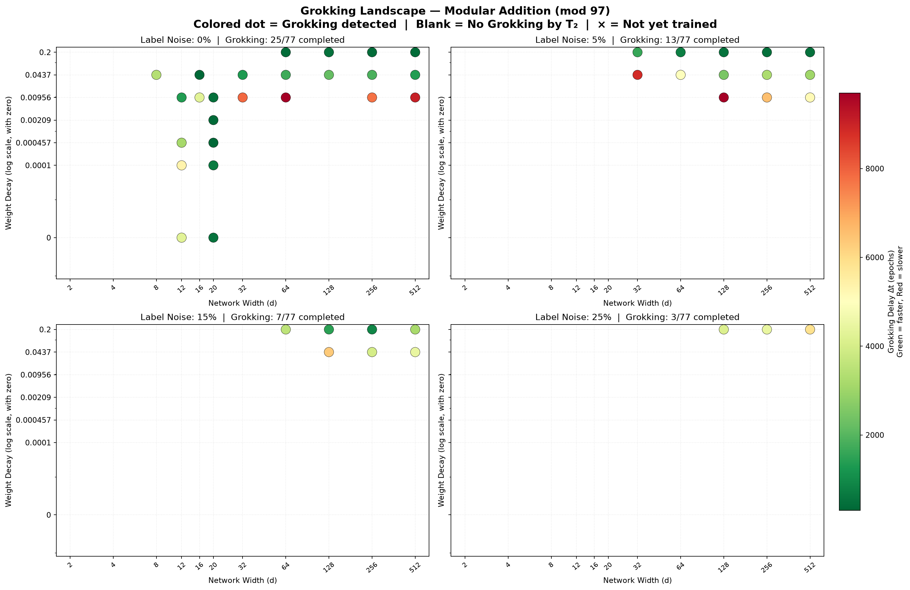
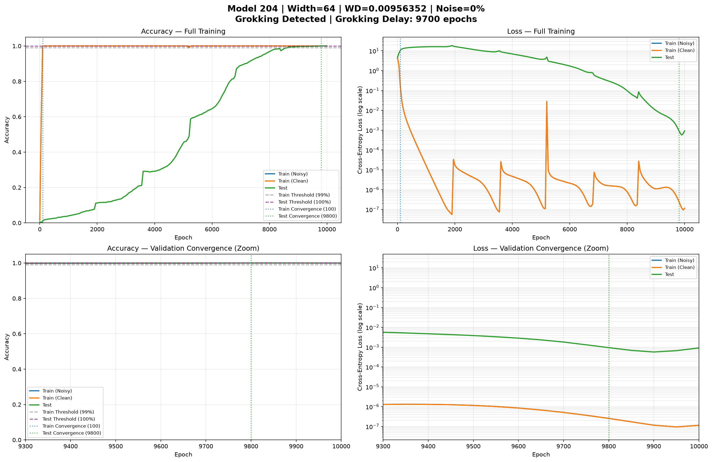

# Grokking in Modular Addition

Grokking is delayed generalization in neural networks. Training accuracy can reach a high level well before accuracy on held-out examples does. This experiment maps the Grokking landscape for modular addition by varying network width, weight decay, and training-label noise. It also explores conditions potentially relevant to Capacity Inversion, where narrower models can outperform wider ones. The research presentation describes the motivation for that question. [Perceived Irreducibility](Perceived%20Irreducibility.pdf)

The model receives two integers, $a$ and $b$, each between 0 and 96 inclusive, and predicts $(a + b) \bmod 97$. The dataset contains all 9,409 ordered input pairs. The notebook uses a 70%/30% train/test split and corrupts labels only in the training set.

## Repository structure

```text
.
├── code.ipynb                         # Main experiment notebook
├── environment.yml                    # Conda/Mamba environment export
├── requirements.txt                   # Python dependency export
├── Perceived Irreducibility.pdf        # Research presentation
└── grokking_experiments/
    ├── configurations.json            # Indexed hyperparameter grid
    ├── datasets/                      # CSVs by label-noise level
    ├── results.csv                    # Aggregated summaries for completed runs
    ├── grokking_landscape.png         # Overview of the sweep
    └── models/model_XXX/              # Artifacts for one configuration
        ├── model.pt                   # Final PyTorch model weights
        ├── history.csv                # Metrics by evaluated epoch
        ├── summary.json               # Configuration, final metrics, and detection fields
        └── learning_curves.png        # Full and zoomed accuracy and loss curves
```

## Environment setup

The original setup used Python 3.12, Jupyter, NumPy, Pandas, Matplotlib, and PyTorch 2.10 with ROCm 7.1 on an AMD GPU. The Conda export pins platform-specific builds and an absolute installation prefix. The pip export contains local `file://` references to Conda build artifacts. Both exports include ROCm-specific packages. If adapting the Conda environment, remove the original prefix, resolve build pins for the target platform, and install the appropriate PyTorch build separately. [Conda export](environment.yml) · [Pip export](requirements.txt)

For a fresh setup, use a Python 3.12 virtual environment. The activation command below is for a POSIX shell.


```bash
git clone https://github.com/YuriMatyash/grokking-tests.git
cd grokking-tests
python3.12 -m venv .venv
source .venv/bin/activate
python -m pip install numpy pandas matplotlib tqdm jupyterlab ipykernel
```

Install PyTorch for your operating system and hardware. On Linux x86-64, the CPU build can be installed with the command below. For a supported AMD GPU, use the ROCm command that matches your platform and ROCm version. [PyTorch installation selector](https://pytorch.org/get-started/locally/)

```bash
python -m pip install 'torch==2.10.0+cpu' --index-url https://download.pytorch.org/whl/cpu
```

Verify the installation from the same environment, then open the notebook with that environment's Python kernel. [Experiment notebook](code.ipynb)

```bash
python -c "import torch; print(torch.__version__); print('HIP:', torch.version.hip); print('GPU available:', torch.cuda.is_available())"
jupyter lab code.ipynb
```

ROCm uses PyTorch's `torch.cuda` API. The notebook selects `cuda:0` when `torch.cuda.is_available()` is true and otherwise uses the CPU. For a fresh run, set `OUT_DIR` to a new path in the Hyper Parameters cell to preserve the committed outputs. Set `RUN_INDICES` to a list of configuration indices to run a subset. The default `None` selects the full grid.

## Dataset and experimental configuration

The notebook randomly permutes the 9,409 pairs once, then takes the first 6,586 for training and the remaining 2,823 for testing. Every noise condition uses the same split. For a given noise percentage, the notebook rounds that fraction of the training-set size to the nearest integer and selects that many indices from a shared random ordering. It adds a pre-sampled offset from 1 to 96 modulo 97, so every selected label changes to an incorrect target. Higher noise levels include the corrupted examples from lower levels and reuse their replacement labels. The CSVs retain the original targets in `cleanLabel` for evaluation.

| Setting | Value |
| --- | --- |
| Network width $d$ | 2, 4, 8, 12, 16, 20, 32, 64, 128, 256, 512 |
| Weight decay | 0 plus six logarithmically spaced values from 0.0001 to 0.2. The four interior values are approximately 0.000457305, 0.00209128, 0.00956352, and 0.0437345. |
| Training-label noise | 0%, 5%, 15%, 25% |
| Optimizer and learning rate | AdamW at 0.001 |
| Batch size | 512 |
| Epochs per model | 10,000 |
| Evaluation | Epoch 1, every 50 epochs, and the final epoch |
| Seeds | 42 for the split, 43 for label corruption (`DATA_SEED + 1`), 42 for model initialization, and `MODEL_SEED + epoch` for shuffling each epoch |

The grid contains 308 configurations, with one run per configuration under the fixed seeding scheme. The committed dataset directory also contains 10% and 20% noise CSVs outside the current sweep. [Configuration grid](grokking_experiments/configurations.json)

## Neural network architecture

`GrokkingMLP` uses one shared `Embedding(97, d)` table for both inputs. Each row is a learned representation of one residue, updated through backpropagation. The width $d$ controls the size of these embeddings and the hidden layers.

| Stage | Per-example shape or operation |
| --- | --- |
| Input | Two integer indices |
| Shared embedding | Two vectors of length $d$, shape $2 \times d$ |
| Concatenation | Flatten to a vector of length $2d$ |
| First hidden layer | Linear $2d \to 4d$, then ReLU |
| Second hidden layer | Linear $4d \to d$, then ReLU |
| Output layer | Linear $d \to 97$ |

The output contains one logit for each possible residue. The predicted class is the index of the largest logit. Including the embedding weights and linear biases, the trainable parameter count is $12d^2 + 199d + 97$. It grows quadratically with width and equals 1,085 at $d = 4$.

## Training methodology

Each epoch shuffles the training examples and processes them in mini-batches. For each batch, the optimizer clears the gradients, the model computes logits in a forward pass, and cross-entropy compares the logits with the training labels at the chosen noise level. Backpropagation computes the gradients, and AdamW updates the parameters. Weight decay is decoupled from the loss gradient in AdamW. The sweep varies its strength while holding the learning rate at 0.001.

At each scheduled evaluation, the notebook measures performance over the full training and test sets. Every 1,000 epochs it saves a checkpoint with the model and optimizer states, epoch, configuration, history, and elapsed time. A matching checkpoint restores those values and resumes at the next epoch. Completed runs with matching saved settings are reused, and the resume checkpoint is removed after the final artifacts are saved.

## Evaluation metrics

The notebook records six metrics in `history.csv` at each evaluated epoch.

| Metric | Definition |
| --- | --- |
| `trainAccuracy` | Fraction of training predictions matching the labels used for optimization, including corrupted targets. |
| `cleanTrainAccuracy` | Fraction of training predictions matching the original modular-addition targets. |
| `testAccuracy` | Fraction of predictions matching the clean targets on held-out test pairs. |
| `trainLoss` | Mean cross-entropy against the training labels used for optimization. |
| `cleanTrainLoss` | Mean cross-entropy against the original training targets. |
| `testLoss` | Mean cross-entropy against the clean held-out test targets. |

Accuracy records whether the highest-scoring class is correct. Cross-entropy penalizes low probability assigned to the target class, so it can change even when the predicted class stays the same. Together they track changes in both classification and confidence over training.

`summary.json` and the aggregated `results.csv` store the six last-evaluation values as the corresponding `final…` fields, such as `finalCleanTrainAccuracy` and `finalTestLoss`. They also record the trainable parameter count (`parameters`) and accumulated elapsed wall-clock time for the run (`elapsedSeconds`), including periodic evaluation and checkpointing. [Aggregated results](grokking_experiments/results.csv)

## Grokking detection methodology

`detect_grokking()` sorts the evaluation history by epoch, discards measurements after $T_2 = 10{,}000$, and keeps the last record for any duplicate epoch. The function then computes the following fields from the remaining evaluations.

| Field | Definition |
| --- | --- |
| `trainConvergenceEpoch` ($t_{\mathrm{train}}$) | First evaluated epoch with `trainAccuracy` at least 0.99 (99%), measured against the labels used for training. |
| `testConvergenceEpoch` ($t_{\mathrm{val}}$) | First evaluated epoch with `testAccuracy` at least `1 - labelNoise / 100`. For example, 15% training-label noise sets the test-accuracy threshold to 85%. |
| `grokkingDelay` ($\Delta t$) | $t_{\mathrm{val}} - t_{\mathrm{train}}$, in epochs, when both convergence epochs are observed. |
| `grokked` | True when both convergence epochs are observed, the delay is at least $T_1 = 200$ epochs, and the validation convergence epoch is at most $T_2 = 10{,}000$. |

If either threshold is never reached within the evaluation window, its convergence epoch and the delay are `null` in JSON (blank in CSV), and `grokked` is false. If both thresholds are reached but the delay is shorter than 200 epochs, the delay is still recorded and `grokked` is false. The summaries also store `trainThreshold` and `testThreshold`.

The notebook uses the held-out test split for periodic validation. Convergence means the first observed threshold crossing in that periodic history. This is an operational definition of delayed generalization based on the chosen thresholds. Establishing an underlying learning mechanism would require separate evidence.

## Results and Grokking landscape



The four panels show 0% and 5% training-label noise on the top row and 15% and 25% on the bottom row. The horizontal axis shows network width $d$ on a base-2 logarithmic scale. The vertical axis shows weight decay on a symmetric logarithmic scale that includes zero. Each panel title gives the number of detections among its completed configurations.

- **Colored circles** mark configurations with `grokked = true`. The shared color bar encodes the delay $\Delta t$ in epochs, with green for shorter delays and red for longer delays.
- **Blank grid positions** indicate completed configurations where the detector returned false by $T_2$.
- **Gray crosses** mark configurations without a completed result. The saved image has none because the results CSV contains all 77 configurations in each panel. [Aggregated results](grokking_experiments/results.csv)

An example of a model that grokked:  
Model #204 : Label Noise: 0% | Network Width: 64 | Weight Decay: 0.00956

